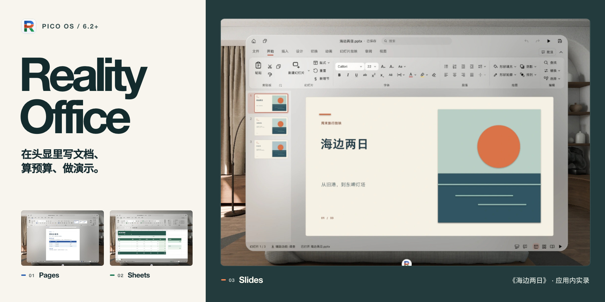
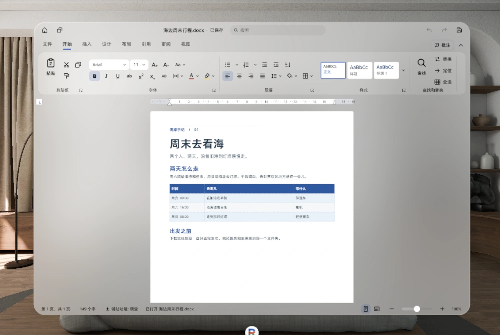
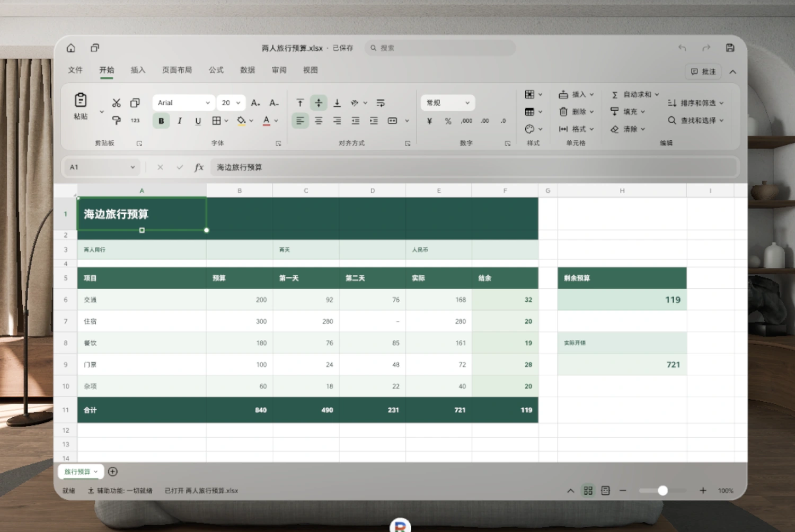
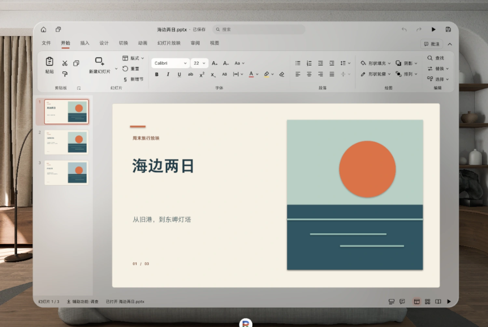
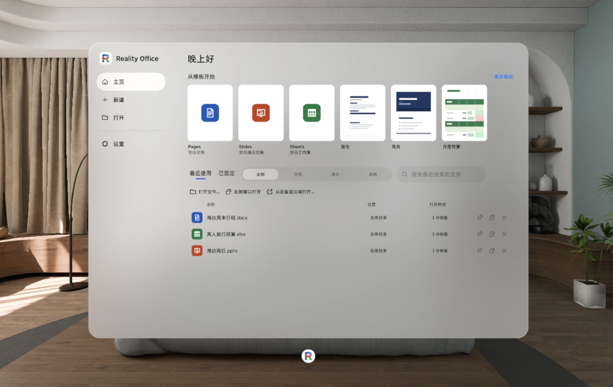

# Reality Office

简体中文 · [English](README.en.md)

**在 PICO 头显里写文档、算预算、做演示。** 打开一份已有的 Office 文件，或从空白页开始。你可以把行程和预算并排放在眼前，改好后保存到头显；即使没有网络，也能接着做。

**[免费下载 1.3.4（APK）](https://github.com/jason-jm/RealityOffice/releases/download/v1.3.4/RealityOffice-v1.3.4.apk)** · [安装到头显](docs/INSTALL.md#简体中文) · [下载海边周末示例（ZIP）](https://raw.githubusercontent.com/jason-jm/RealityOffice/main/examples/coast-weekend/coast-weekend-zh-CN.zip)

适用于运行 **PICO OS 6.2 或更高版本**的 arm64 头显。支持 18 种界面语言，无需注册应用账号。

## 一个海边周末，三份打开就能改的文件

周六在旧港吃早餐，周日沿海堤走到灯塔。下面的行程、预算和幻灯片都在同一个[示例包](examples/coast-weekend/)里。海报和界面图均截自正式版 1.3.4 在 **PICO OS 6.2 模拟器**中的实际画面；点图可查看大图。

### Pages · 把周末写成一张行程表

在《海边周末行程》里，出发时间、目的地和要带的东西排成三列。换掉一站，在「出发之前」补一句提醒，再保存成 DOCX。回到电脑上，行程还是一份可以继续编辑的文档。

### Sheets · 看看旅费还剩多少

两个人的预算是 840 元，交通、住宿和餐饮等一共花了 721 元，还剩 119 元。打开《两人旅行预算》，把第一天的餐费从 76 元改成 90 元，表里的剩余预算就会变成 105 元。

### Slides · 把两天的故事讲给人听

《海边两日》用三张幻灯片串起旧港、海堤和灯塔。把标题和讲者备注换成自己的，点「从头放映」就能排练。想放大看？选择「投影到墙面」后，允许空间访问即可贴合检测到的墙面；也可以在前方的浮空面板上放映。

第一次打开？看看 Reality Office 首页

首页可以新建空白文档、从模板起步，也能找到最近打开的文件。试用示例时，先在电脑上解压 ZIP，把三个文件复制到头显的「下载」文件夹，再从首页「打开」中选择文件。

## 用自己的文件

Pages、Sheets 和 Slides 分别读写 **DOCX、XLSX、PPTX**，也支持 OpenDocument 的 **ODT、ODS、ODP**。如果文件含有复杂排版或特殊对象，可以先用副本试一下；[格式与功能说明](docs/FEATURES.md)列出了支持范围。

编辑和保存都在设备上完成，正式版没有申请 Android 互联网权限。如果主动通过系统文件选择器使用云盘，则由所选服务处理相应文件。[隐私说明](DATA.md#简体中文)

[版本记录](https://github.com/jason-jm/RealityOffice/releases) · [反馈问题](https://github.com/jason-jm/RealityOffice/issues) · [从源码构建](docs/BUILDING.md) · [MIT 开源许可证](LICENSE) · [第三方声明](THIRD_PARTY_NOTICES.md)
