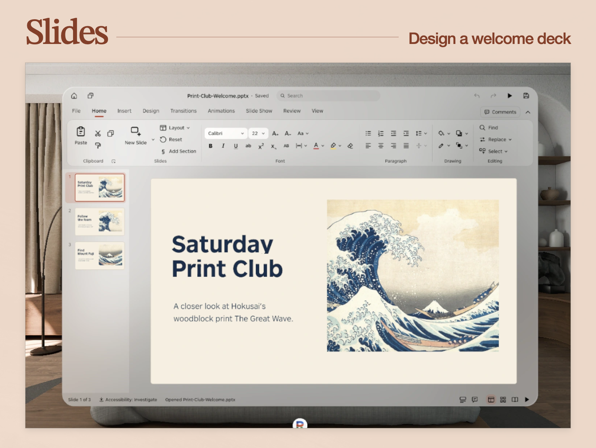

# Reality Office on PICO Space Pro

Home, Pages, Sheets and Slides are shown with the same Saturday Print Club files. The four feature posters open their original screenshots when you click them. [Choose a language](../languages/README.md) · [Download the editable examples](../../examples/print-club/)

  <a href="cover-en.jpg">
    <picture>
      <source media="(max-width: 600px)" srcset="cover-en-mobile.jpg">
      
    </picture>
  </a>

## How the posters were made

The four English screenshots come from the signed 1.3.4 release (build 9) running in the PICO OS 6.2.0 emulator. The room around each window is part of the simulator. Each capture was cropped from a square 3200 × 3200 view and scaled proportionally to 1500 pixels wide. The feature posters place these images at their full 1500-pixel width. All 18 product guides share the same artwork. [PICO’s device and emulator FAQ](https://developer.picoxr.com/document/discover/faqs-for-project-swan-and-pico-os-6/)

To reproduce the posters, open the [layout](cover-layout.html) in Chromium from a local checkout. Select a single poster by adding `#cover`, `#home`, `#pages`, `#sheets` or `#slides` to the address. Set the viewport to 1640 pixels wide at 1× and capture the selected element. Save the desktop cover as JPEG. Capture `#cover` again at 420 pixels wide and 2× to export the single-column mobile JPEG. For each feature poster, place the original screenshot at its native size, 70 pixels from the left and 173 from the top, then export as lossless WebP. The generated blue ink texture sits behind the typography and original captures. [Background texture](print-texture.webp)

The woodblock print pictured inside Slides is in the public domain. [The Metropolitan Museum of Art, object 45434](https://www.metmuseum.org/art/collection/search/45434)
