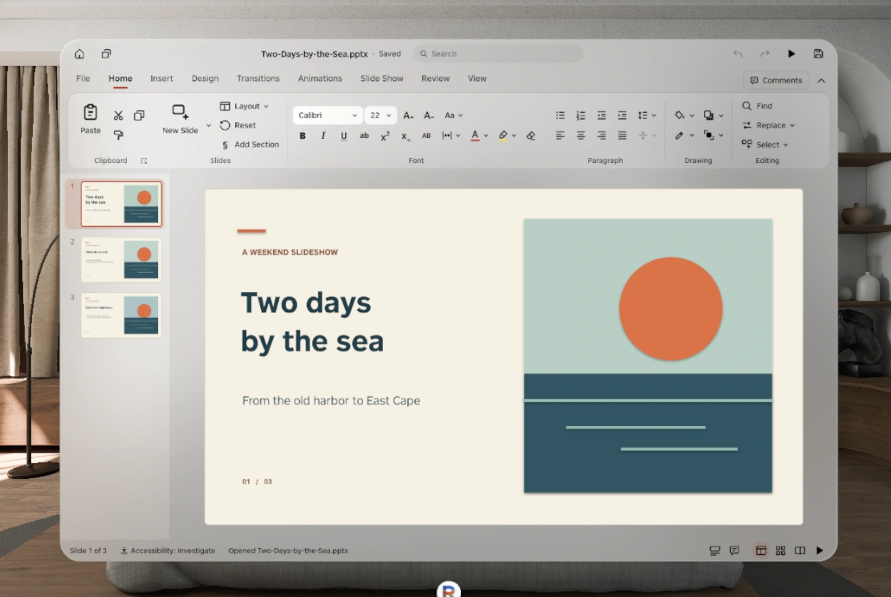
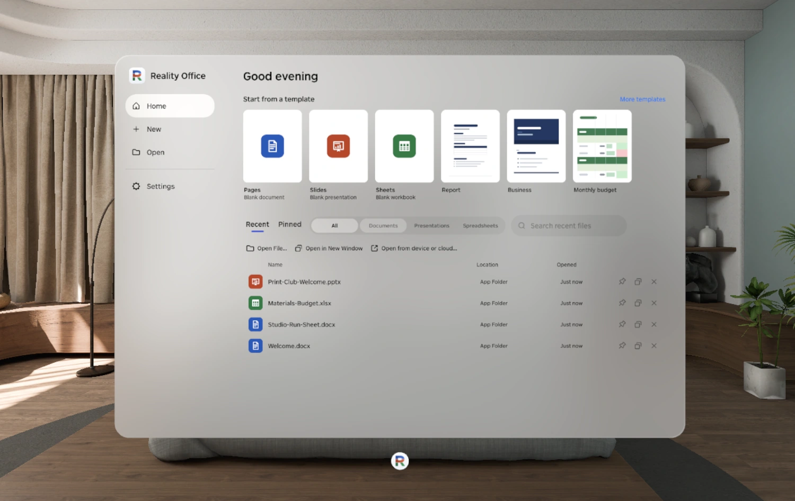

# Reality Office untuk PICO Space Pro

[English](../../README.md) · [Deutsch](de.md) · [Español](es.md) · [Français](fr.md) · **Bahasa Indonesia** · [Italiano](it.md) · [Nederlands](nl.md) · [Polski](pl.md) · [Português (Brasil)](pt-BR.md) · [Русский](ru.md) · [Türkçe](tr.md) · [Tiếng Việt](vi.md) · [हिन्दी](hi.md) · [ไทย](th.md) · [日本語](ja.md) · [한국어](ko.md) · [简体中文](zh-CN.md) · [繁體中文](zh-TW.md)

Reality Office adalah aplikasi perkantoran gratis dan bersumber terbuka yang dirancang untuk PICO Space Pro. Buka rencana kegiatan di samping lembar kerja, periksa angkanya, lalu masukkan ke presentasi. Ketiga editornya dapat digunakan tanpa internet dan menyimpan berkas di headset. Anda bisa langsung mulai tanpa membuat akun.

**[Unduh versi 1.3.4 (APK)](https://github.com/jason-jm/RealityOffice/releases/download/v1.3.4/RealityOffice-v1.3.4.apk)** · [Panduan pemasangan (EN)](../INSTALL.md#english) · [Unduh berkas contoh (ZIP)](https://raw.githubusercontent.com/jason-jm/RealityOffice/main/examples/print-club/Saturday-Print-Club.zip)

Memerlukan **PICO OS 6.2 atau lebih baru** pada perangkat arm64. Antarmuka aplikasi tersedia dalam 18 bahasa.

## Sabtu di studio seni cetak

Studio buka pukul sepuluh. Sebelum tamu datang, pembawa acara perlu merapikan jadwal, menghitung biaya kertas, dan berlatih menyampaikan sambutan. Coba sendiri dengan ketiga berkas contoh. Gambar menampilkan versi 1.3.4 berbahasa Inggris yang berjalan di emulator PICO OS 6.2.

### Pages · Susun jadwal studio

Jadwal mencantumkan waktu dan tempat untuk setiap kegiatan. Mundurkan waktu peragaan mencetak yang pertama, tambahkan catatan untuk para relawan, lalu simpan sebagai DOCX.

### Sheets · Hitung biaya tambahan satu pak kertas

Empat pak kertas, tinta, rol, dan label menghabiskan 96 euro. Ubah jumlah kertas dari empat menjadi lima pak. Totalnya naik menjadi 108 euro dan dari anggaran 120 euro tersisa 12 euro.

### Slides · Latih sambutan pembuka

Slide pembuka menampilkan cuplikan karya Hokusai, *Ombak Besar*. Dua slide berikutnya mengajak penonton mengamati buih ombak, lalu Gunung Fuji. Tambahkan pengingat di catatan pembicara dan mulai presentasi. Anda dapat menampilkan slide pada panel melayang atau mengizinkan akses data spasial untuk menempatkannya pada dinding yang terdeteksi.

Lihat layar utama

## Lanjutkan dengan berkas Anda sendiri

Pages, Sheets, dan Slides dapat membuka dan menyimpan berkas **DOCX, XLSX, PPTX** serta **ODT, ODS, ODP**. Buka berkas yang sudah ada atau pilih templat di layar utama. Berkas lokal tetap ada di headset sampai Anda memilih untuk menyalin atau membagikannya.

[Format yang didukung (EN)](../FEATURES.md) · [Privasi (EN)](../../DATA.md#english) · [Kompilasi dari kode sumber (EN)](../BUILDING.md) · [Lisensi MIT](../../LICENSE)
