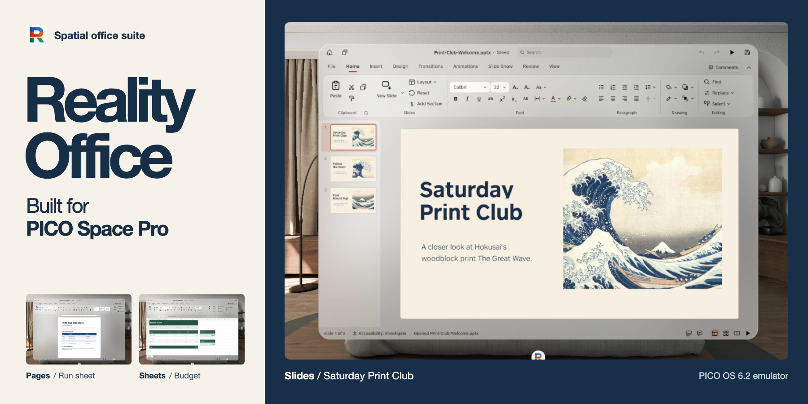

# PICO Space Pro のための Reality Office

[English](../../README.md) · [Deutsch](de.md) · [Español](es.md) · [Français](fr.md) · [Bahasa Indonesia](id.md) · [Italiano](it.md) · [Nederlands](nl.md) · [Polski](pl.md) · [Português (Brasil)](pt-BR.md) · [Русский](ru.md) · [Türkçe](tr.md) · [Tiếng Việt](vi.md) · [हिन्दी](hi.md) · [ไทย](th.md) · **日本語** · [한국어](ko.md) · [简体中文](zh-CN.md) · [繁體中文](zh-TW.md)

Reality Office は PICO Space Pro 向けの無料で使えるオープンソースのオフィスソフトです。企画書と表計算シートを並べて数字を確かめ、そのまま別のウィンドウで発表資料に反映できます。3 つのエディターはオフラインで使え、ファイルはヘッドセットに保存されます。アプリのアカウント登録は不要です。

**[1.3.4 をダウンロード（APK）](https://github.com/jason-jm/RealityOffice/releases/download/v1.3.4/RealityOffice-v1.3.4.apk)** · [インストールガイド (EN)](../INSTALL.md#english) · [サンプルファイル（ZIP）](https://raw.githubusercontent.com/jason-jm/RealityOffice/main/examples/print-club/Saturday-Print-Club.zip)

arm64 の **PICO OS 6.2 以降**に対応。アプリの表示言語は 18 種類から選べます。

## 土曜日の版画教室

工房が開くのは午前 10 時。それまでに進行表を仕上げ、用紙代を計算し、開会の挨拶を練習します。3 つのサンプルファイルで試してみてください。画像は PICO OS 6.2 エミュレーターで動作する正式版 1.3.4 の英語画面です。

### Pages · 当日の進行表を整える

進行表には各活動の時刻と場所が並んでいます。最初の実演を少し遅らせ、スタッフへの申し送りを書き足したら、DOCX 形式で保存できます。

### Sheets · 用紙を一包み追加する

用紙 4 包とインク、ローラー、ラベルの合計は 96 ユーロ。用紙を 5 包に変更すると合計は 108 ユーロになり、120 ユーロの予算から 12 ユーロが残ります。

### Slides · 開会の挨拶を練習する

表紙は葛飾北斎の「神奈川沖浪裏」の一部。続く 2 枚で波しぶきから富士山へと目を移します。発表者ノートに一言書き添えて、スライドショーを開始しましょう。目の前のパネルで上映できるほか、空間データへのアクセスを許可すると、検出した壁に表示できます。

ホーム画面を見る

## 手元のファイルを使う

Pages、Sheets、Slides は **DOCX、XLSX、PPTX** と **ODT、ODS、ODP** の読み書きに対応しています。ホーム画面でテンプレートを選ぶか、手元のファイルを開いてください。ローカルファイルは自分でコピーや共有を行うまでヘッドセット内に保存されます。

[対応形式 (EN)](../FEATURES.md) · [プライバシー (EN)](../../DATA.md#english) · [ソースからビルド (EN)](../BUILDING.md) · [MIT ライセンス](../../LICENSE)
