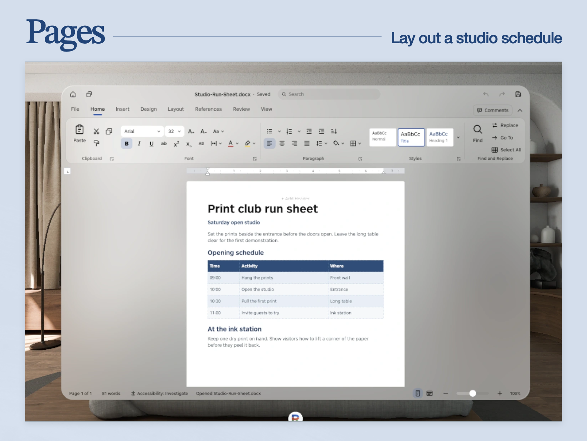

# Reality Office для PICO Space Pro

[English](../../README.md) · [Deutsch](de.md) · [Español](es.md) · [Français](fr.md) · [Bahasa Indonesia](id.md) · [Italiano](it.md) · [Nederlands](nl.md) · [Polski](pl.md) · [Português (Brasil)](pt-BR.md) · **Русский** · [Türkçe](tr.md) · [Tiếng Việt](vi.md) · [हिन्दी](hi.md) · [ไทย](th.md) · [日本語](ja.md) · [한국어](ko.md) · [简体中文](zh-CN.md) · [繁體中文](zh-TW.md)

[Официальный сайт](https://jason-jm.github.io/RealityOffice/guides/ru/) · [Видео о приложении](https://jason-jm.github.io/RealityOffice/#film)

Reality Office — бесплатный офисный пакет с открытым исходным кодом для **PICO Space Pro**. В [Pages](#pages-editor) можно писать и рецензировать документы, в [Sheets](#sheets-editor) — анализировать данные, а в [Slides](#slides-editor) — готовить и показывать презентации. Все три редактора работают без интернета. Можно держать перед глазами исходный документ, работать с другим файлом в соседнем окне и продолжить редактирование на компьютере.

**[Скачать версию 1.3.4 (APK)](https://github.com/jason-jm/RealityOffice/releases/download/v1.3.4/RealityOffice-v1.3.4.apk)** · [Инструкция по установке (EN)](../INSTALL.md#english)

Требуется **PICO OS 6.2 или новее** на устройстве arm64. Интерфейс доступен на 18 языках.

  <a href="../gallery/cover-en.jpg">
    <picture>
      <source media="(max-width: 600px)" srcset="../gallery/cover-en-mobile.jpg">
      
    </picture>
  </a>

## Работа с несколькими окнами

Откройте второй файл в новом окне. Так удобно сверяться с техническим заданием, пока пишете предложение, или проверять цифры в таблице, пока обновляете диаграмму в презентации. На главном экране есть шаблоны отчётов, бюджетов и презентаций. Недавние файлы можно искать, а часто используемые — закреплять. В каждом редакторе есть справочник сочетаний клавиш для физической клавиатуры.

## Pages · Оформление и рецензирование документов

Примените к разделам отчёта стили заголовков. Между ними можно переключаться в структуре документа и по ним же создать оглавление со ссылками и номерами страниц. Вставляйте в текст изображения, таблицы и сноски. Название документа или номер страницы можно вынести в колонтитул.

Если вам прислали исправленный черновик, сравните версии и посмотрите различия в отдельном документе. В режиме записи исправлений видно, кто внёс правку. Каждую из них можно принять или отклонить отдельно. К выделенному отрывку можно добавить комментарий, ответить в том же обсуждении и отметить его завершённым после согласования текста.

## Sheets · Формулы, диаграммы и анализ данных

Используйте ссылки на другие листы, чтобы рассчитывать бюджет, составлять заказы или строить прогнозы. Функция `SUMIFS` суммирует строки, которые удовлетворяют нескольким условиям, а `XLOOKUP` подставляет подходящую цену из прайс-листа. Если целевой результат уже известен, подбор параметра поможет найти исходное значение, например цену за единицу, при которой заказ уложится в бюджет.

Закрепите строку заголовков, отсортируйте записи по нескольким столбцам и оставьте нужные строки с помощью фильтра. Выпадающие списки помогают вводить значения единообразно, а условное форматирование выделяет суммы выше лимита. Столбчатая диаграмма удобна для сравнения категорий, линейная — для динамики, круговая — для долей от общей суммы.

## Slides · Подготовка, репетиция и показ в пространстве

Выберите макет, выровняйте текст и изображения по направляющим, добавьте таблицы или диаграммы. Настройте переходы и анимацию отдельных объектов, чтобы они появлялись по ходу рассказа. К каждому слайду можно добавить заметки, а при репетиции записать время его показа.

Во время выступления презентация идёт на отдельной панели. В режиме докладчика видны заметки, текущий слайд и следующий. Если разрешить доступ к пространственным данным, гарнитура сможет разместить панель на обнаруженной стене. Когда стена не найдена или доступ не предоставлен, слайды остаются на парящей панели перед вами.

## Форматы файлов и экспорт в PDF

| Редактор | Открытие и сохранение | Также открывает |
| --- | --- | --- |
| Pages | DOCX, ODT, TXT | DOC, RTF |
| Sheets | XLSX, ODS, CSV | XLS |
| Slides | PPTX, ODP | PPT |

Все три редактора экспортируют готовую работу в PDF. Изменения в старых файлах DOC, XLS и PPT сохраняются в новом формате рядом с оригиналом. Для обмена значениями одного листа подойдёт CSV. Чтобы сохранить формулы, оформление и несколько листов, выберите XLSX или ODS.

## Работа без сети, конфиденциальность и восстановление

Чтобы открывать и сохранять файлы в гарнитуре, учётная запись приложения не нужна. Выпущенный APK не запрашивает у Android разрешения на доступ в интернет. Если выбрать облачный диск в системном окне выбора файлов, выбранные файлы обработает этот сервис.

Автосохранение записывает изменения, а для восстановления после сбоя хранится локальный черновик. Если открытый файл изменит другое приложение, автосохранение приостановится, чтобы вы могли выбрать версию. Обнаружив содержимое, которое невозможно редактировать, например макросы, Reality Office предложит сохранить копию, прежде чем заменять оригинал.

## Попробуйте редакторы

На снимках показана английская версия 1.3.4 в эмуляторе PICO OS 6.2. Скачайте те же файлы, чтобы отредактировать расписание, пересчитать бюджет или отрепетировать выступление с тремя слайдами и заметками докладчика.

[Скачать примеры (ZIP)](https://raw.githubusercontent.com/jason-jm/RealityOffice/main/examples/print-club/Saturday-Print-Club.zip)

[Поддерживаемые форматы (EN)](../FEATURES.md) · [Конфиденциальность (EN)](../../DATA.md#english) · [Сборка из исходного кода (EN)](../BUILDING.md) · [Лицензия MIT](../../LICENSE)
