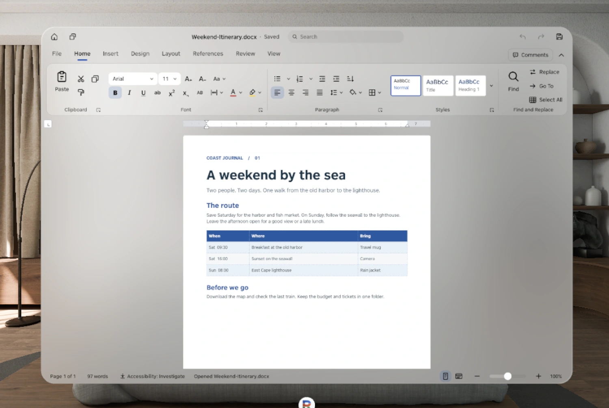

# PICO Space Pro için Reality Office

[English](../../README.md) · [Deutsch](de.md) · [Español](es.md) · [Français](fr.md) · [Bahasa Indonesia](id.md) · [Italiano](it.md) · [Nederlands](nl.md) · [Polski](pl.md) · [Português (Brasil)](pt-BR.md) · [Русский](ru.md) · **Türkçe** · [Tiếng Việt](vi.md) · [हिन्दी](hi.md) · [ไทย](th.md) · [日本語](ja.md) · [한국어](ko.md) · [简体中文](zh-CN.md) · [繁體中文](zh-TW.md)

Reality Office, PICO Space Pro için geliştirilmiş ücretsiz ve açık kaynaklı bir ofis paketidir. Çalışma planınızı hesap tablosunun yanında açın, bir tutarı kontrol edin ve sununuza aktarın. Üç düzenleyici de çevrimdışı çalışır ve dosyalarınızı başlığa kaydeder. Başlamak için hesap açmanız gerekmez.

**[1.3.4 sürümünü indir (APK)](https://github.com/jason-jm/RealityOffice/releases/download/v1.3.4/RealityOffice-v1.3.4.apk)** · [Kurulum kılavuzu (EN)](../INSTALL.md#english) · [Örnek dosyaları indir (ZIP)](https://raw.githubusercontent.com/jason-jm/RealityOffice/main/examples/print-club/Saturday-Print-Club.zip)

arm64 cihazlarda **PICO OS 6.2 veya üzeri** gerekir. Uygulama arayüzü 18 dilde kullanılabilir.

## Baskı atölyesinde bir cumartesi

Atölye saat onda açılıyor. Öncesinde programı tamamlamak, kâğıt siparişinin tutarını hesaplamak ve açılış konuşmasını prova etmek gerekiyor. Üç örnek dosyayla siz de deneyebilirsiniz. Görseller, PICO OS 6.2 emülatöründe çalışan 1.3.4 sürümünün İngilizce arayüzünü gösterir.

### Pages · Atölye programını hazırlayın

Programda her etkinliğin saati ve yeri yan yana yer alır. İlk baskı gösterisini daha geç bir saate alın, gönüllüler için bir hatırlatma ekleyin ve belgeyi DOCX olarak kaydedin.

### Sheets · Bir paket daha kâğıdın maliyetini hesaplayın

Dört paket kâğıt, mürekkep, merdaneler ve etiketler toplam 96 avro tutuyor. Kâğıt miktarını dörtten beşe çıkarın. Toplam tutar 108 avroya yükselir ve 120 avroluk bütçeden 12 avro kalır.

### Slides · Açılış konuşmasını prova edin

İlk slaytta Hokusai’nin *Büyük Dalga* eserinden bir ayrıntı yer alır. Sonraki iki slayt bakışları köpüklerden Fuji Dağı’na yöneltir. Konuşmacı notlarınıza bir ipucu ekleyip gösteriyi başlatın. Slaytları havada duran bir panelde ya da mekânsal verilere erişim izni vererek algılanan bir duvarda gösterebilirsiniz.

Ana ekranı görüntüle

## Kendi dosyalarınızla çalışın

Pages, Sheets ve Slides hem **DOCX, XLSX ve PPTX** hem de **ODT, ODS ve ODP** dosyalarını açar ve kaydeder. Ana ekrandan bir şablon seçebilir ya da mevcut bir dosyayı açabilirsiniz. Yerel dosyalar, siz kopyalamayı veya paylaşmayı seçene kadar başlıkta kalır.

[Desteklenen biçimler (EN)](../FEATURES.md) · [Gizlilik (EN)](../../DATA.md#english) · [Kaynak koddan derleme (EN)](../BUILDING.md) · [MIT lisansı](../../LICENSE)
