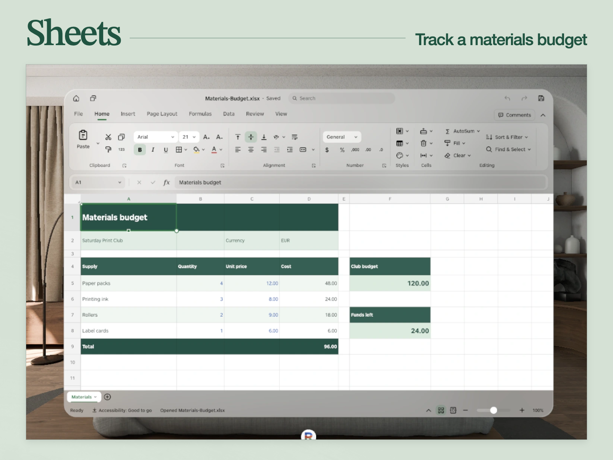

# Reality Office dành cho PICO Space Pro

[English](../../README.md) · [Deutsch](de.md) · [Español](es.md) · [Français](fr.md) · [Bahasa Indonesia](id.md) · [Italiano](it.md) · [Nederlands](nl.md) · [Polski](pl.md) · [Português (Brasil)](pt-BR.md) · [Русский](ru.md) · [Türkçe](tr.md) · **Tiếng Việt** · [हिन्दी](hi.md) · [ไทย](th.md) · [日本語](ja.md) · [한국어](ko.md) · [简体中文](zh-CN.md) · [繁體中文](zh-TW.md)

[Trang web chính thức](https://jason-jm.github.io/RealityOffice/guides/vi/) · [Video giới thiệu](https://jason-jm.github.io/RealityOffice/#film)

Reality Office là bộ ứng dụng văn phòng miễn phí, mã nguồn mở, dành cho **PICO Space Pro**. Bạn có thể soạn và rà soát tài liệu trong [Pages](#pages-editor), phân tích dữ liệu trong [Sheets](#sheets-editor), rồi thiết kế và trình chiếu với [Slides](#slides-editor). Cả ba đều hoạt động ngoại tuyến. Hãy mở tài liệu tham khảo bên cạnh cửa sổ đang làm việc, rồi chuyển chính các tệp đó sang máy tính để chỉnh sửa tiếp.

**[Tải phiên bản 1.3.4 (APK)](https://github.com/jason-jm/RealityOffice/releases/download/v1.3.4-build10/RealityOffice-v1.3.4-build10.apk)** · [Hướng dẫn cài đặt (EN)](../INSTALL.md#english)

Yêu cầu **PICO OS 6.2 trở lên** trên thiết bị arm64. Giao diện ứng dụng có 18 ngôn ngữ.

  <a href="../gallery/cover-en.jpg">
    <picture>
      <source media="(max-width: 600px)" srcset="../gallery/cover-en-mobile.jpg">
      
    </picture>
  </a>

## Làm việc với nhiều cửa sổ

Mở tệp thứ hai trong cửa sổ mới. Bạn có thể vừa xem bản yêu cầu vừa viết đề xuất, hoặc đối chiếu số liệu trên bảng tính khi cập nhật biểu đồ trong bài thuyết trình. Từ màn hình chính, bạn có thể chọn mẫu báo cáo, ngân sách hay bài trình bày, tìm tệp đã mở gần đây và ghim tài liệu thường dùng. Mỗi trình soạn thảo đều có hướng dẫn phím tắt cho bàn phím vật lý.

## Pages · Dàn trang và rà soát tài liệu

Áp dụng kiểu tiêu đề cho các phần của báo cáo để chuyển nhanh giữa các phần từ dàn ý và tạo mục lục có liên kết, số trang. Bạn có thể chèn hình ảnh, bảng và chú thích cuối trang vào văn bản. Dùng đầu trang hoặc chân trang để lặp lại tên báo cáo hoặc số trang.

Khi nhận lại bản đã chỉnh sửa, hãy so sánh hai phiên bản để xem các điểm khác biệt trong một tài liệu riêng. Tính năng theo dõi thay đổi cho biết ai đã sửa và cho phép chấp nhận hoặc từ chối từng thay đổi. Bạn có thể bình luận ngay trên một đoạn văn, trả lời trong cùng cuộc trao đổi và đánh dấu đã giải quyết khi chốt được cách diễn đạt.

## Sheets · Công thức, biểu đồ và phân tích dữ liệu

Dùng công thức tham chiếu nhiều trang tính để lập ngân sách, đơn hàng hoặc dự báo. `SUMIFS` cộng các dòng thỏa nhiều điều kiện, còn `XLOOKUP` tra đơn giá phù hợp trong bảng giá. Nếu đã biết kết quả mong muốn, tính năng tìm giá trị mục tiêu có thể tính ngược đầu vào, chẳng hạn đơn giá cần có để đơn hàng nằm trong ngân sách.

Cố định hàng tiêu đề khi cuộn, sắp xếp theo nhiều cột và lọc ra đúng các bản ghi cần xem. Danh sách thả xuống giúp nhập liệu nhất quán. Định dạng có điều kiện làm nổi bật khoản vượt mức. Biểu đồ cột giúp so sánh các nhóm, biểu đồ đường thể hiện xu hướng, còn biểu đồ tròn cho thấy tỷ trọng từng phần.

## Slides · Thiết kế, tập dượt và trình chiếu trong không gian

Chọn bố cục trang chiếu, dùng đường căn chỉnh để sắp chữ và hình rồi thêm bảng hoặc biểu đồ. Bạn có thể đặt hiệu ứng chuyển trang hoặc cho từng đối tượng xuất hiện đúng lúc trình bày. Mỗi trang chiếu có chỗ cho ghi chú của người thuyết trình và có thể ghi lại thời gian dừng ở trang đó khi tập dượt.

Khi bài được chiếu trên một khung riêng, màn hình của người thuyết trình vẫn hiển thị ghi chú, trang hiện tại và trang tiếp theo. Nếu bạn cho phép truy cập dữ liệu không gian, kính có thể đặt khung trình chiếu trên bức tường được nhận diện. Nếu không tìm thấy tường hoặc bạn không cấp quyền, bài trình chiếu vẫn nằm trên khung nổi trước mặt.

## Định dạng tệp và xuất PDF

| Trình soạn thảo | Mở và lưu | Định dạng cũng có thể mở |
| --- | --- | --- |
| Pages | DOCX, ODT, TXT | DOC, RTF |
| Sheets | XLSX, ODS, CSV | XLS |
| Slides | PPTX, ODP | PPT |

Cả ba trình soạn thảo đều xuất được bản hoàn chỉnh sang PDF. Khi sửa tệp DOC, XLS hoặc PPT cũ, các thay đổi được lưu dưới định dạng mới cạnh tệp gốc. CSV phù hợp để trao đổi các giá trị trên một trang tính. Chọn XLSX hoặc ODS để giữ công thức, định dạng và nhiều trang tính trong cùng một tệp.

## Chỉnh sửa ngoại tuyến, quyền riêng tư và khôi phục

Bạn có thể mở và lưu tệp ngay trên kính mà không cần tài khoản ứng dụng. Bản APK phát hành không yêu cầu quyền internet của Android. Nếu bạn chọn ổ đĩa đám mây trong trình chọn tệp của hệ thống, nhà cung cấp dịch vụ đó sẽ xử lý các tệp bạn chọn.

Tự động lưu ghi thay đổi vào tệp, còn tính năng khôi phục giữ bản nháp trên thiết bị để bạn lấy lại khi công việc bị gián đoạn. Nếu một ứng dụng khác thay đổi tệp đang mở, thao tác tự động lưu sẽ tạm dừng để bạn chọn phiên bản cần giữ. Khi phát hiện nội dung không thể chỉnh sửa như macro, Reality Office đề nghị lưu bản sao trước khi thay thế bản gốc.

## Dùng thử các trình soạn thảo

Hình ảnh được chụp từ phiên bản 1.3.4 với giao diện tiếng Anh trên trình giả lập PICO OS 6.2. Hãy tải các tệp trong hình để chỉnh sửa lịch hoạt động, tính lại ngân sách bằng công thức và tập thuyết trình ba trang với ghi chú của người trình bày.

[Tải tệp mẫu (ZIP)](https://raw.githubusercontent.com/jason-jm/RealityOffice/main/examples/print-club/Saturday-Print-Club.zip)

[Định dạng được hỗ trợ (EN)](../FEATURES.md) · [Quyền riêng tư (EN)](../../DATA.md#english) · [Biên dịch từ mã nguồn (EN)](../BUILDING.md) · [Giấy phép MIT](../../LICENSE)
