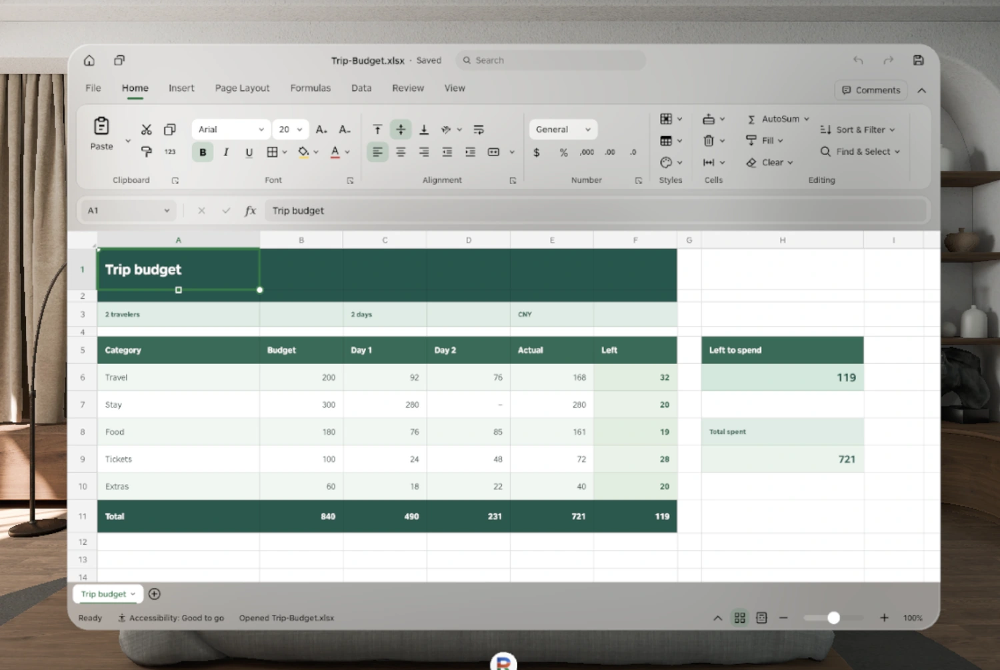

# 为 PICO Space Pro 打造的 Reality Office

[English](../../README.md) · [Deutsch](de.md) · [Español](es.md) · [Français](fr.md) · [Bahasa Indonesia](id.md) · [Italiano](it.md) · [Nederlands](nl.md) · [Polski](pl.md) · [Português (Brasil)](pt-BR.md) · [Русский](ru.md) · [Türkçe](tr.md) · [Tiếng Việt](vi.md) · [हिन्दी](hi.md) · [ไทย](th.md) · [日本語](ja.md) · [한국어](ko.md) · **简体中文** · [繁體中文](zh-TW.md)

Reality Office 是一套为 PICO Space Pro 打造的免费开源办公软件。把活动安排放在预算表旁，核对完数字，就能在另一个窗口里接着做演示。三个编辑器都可以离线使用，文件保存在头显上，打开应用就能开始，无需注册账号。

**[下载 1.3.4 安装包（APK）](https://github.com/jason-jm/RealityOffice/releases/download/v1.3.4/RealityOffice-v1.3.4.apk)** · [安装指南](../INSTALL.md#简体中文) · [下载示例文件（ZIP）](https://raw.githubusercontent.com/jason-jm/RealityOffice/main/examples/print-club/Saturday-Print-Club.zip)

适用于运行 **PICO OS 6.2 或更高版本**的 arm64 设备，应用界面有 18 种语言可选。

## 版画工作室的周六上午

工作室十点开门。开场前，主持人要排好流程、算清用纸成本，还得把欢迎演讲练一遍。下载这三份示例就能跟着试。下图均为正式版 1.3.4 在 PICO OS 6.2 模拟器中的英文界面实录。

### Pages · 排好开场流程

流程表把每项活动的时间和地点列在一起。你可以把第一场印刷演示推迟半小时，给志愿者留句提醒，再把修改存回 DOCX。

### Sheets · 多买一包纸要花多少

四包纸加上油墨、滚筒和标签，一共 96 欧元。在表格中把纸的数量从四包改成五包，总价就变成 108 欧元，120 欧元的预算还剩 12 欧元。

### Slides · 排练欢迎演讲

封面展示了葛饰北斋《神奈川冲浪里》的局部，另两张幻灯片带观众从浪花看到远处的富士山。写好演讲者备注就可以放映。幻灯片可以浮在面前，也可以在授予空间访问权限后投影到检测到的墙面。

查看应用首页

## 用自己的文件接着做

Pages、Sheets 和 Slides 可以读写 **DOCX、XLSX、PPTX** 和 **ODT、ODS、ODP**。可以从首页的模板起步，也能打开已有文件。本地文件保存在头显上，由你决定何时复制或分享。

[格式支持 (EN)](../FEATURES.md) · [隐私说明](../../DATA.md#简体中文) · [从源码构建 (EN)](../BUILDING.md) · [MIT 许可证](../../LICENSE)
