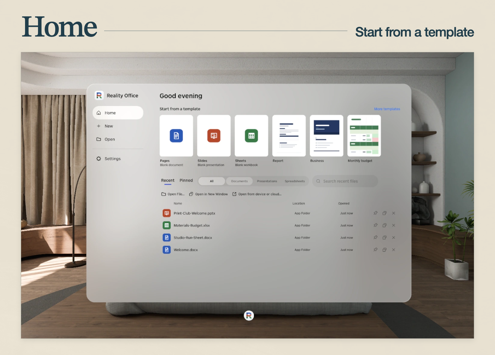

# 为 PICO Space Pro 打造的 Reality Office

[English](../../README.md) · [Deutsch](de.md) · [Español](es.md) · [Français](fr.md) · [Bahasa Indonesia](id.md) · [Italiano](it.md) · [Nederlands](nl.md) · [Polski](pl.md) · [Português (Brasil)](pt-BR.md) · [Русский](ru.md) · [Türkçe](tr.md) · [Tiếng Việt](vi.md) · [हिन्दी](hi.md) · [ไทย](th.md) · [日本語](ja.md) · [한국어](ko.md) · **简体中文** · [繁體中文](zh-TW.md)

Reality Office 是专为 **PICO Space Pro** 打造的免费开源办公套件。用 [Pages](#pages-editor) 写作、排版和审阅文档，用 [Sheets](#sheets-editor) 做计算和分析，用 [Slides](#slides-editor) 制作并放映演示文稿。三个编辑器都能离线工作。你可以把参考资料和正在编辑的文件并排放在眼前，做完后把文件带回电脑继续编辑。

**[下载 1.3.4 安装包（APK）](https://github.com/jason-jm/RealityOffice/releases/download/v1.3.4/RealityOffice-v1.3.4.apk)** · [安装指南](../INSTALL.md#简体中文)

适用于运行 **PICO OS 6.2 或更高版本**的 arm64 设备，应用界面有 18 种语言可选。

  <a href="../gallery/cover-en.jpg">
    <picture>
      <source media="(max-width: 600px)" srcset="../gallery/cover-en-mobile.jpg">
      
    </picture>
  </a>

## 在空间里并排办公

选择「在新窗口打开」，就能对照两份文件工作。写方案时，可以把需求文档放在旁边。做演示时，可以打开预算表核对图表里的数字。首页提供报告、预算和演示模板，也能搜索最近打开的文件，把常用文档固定在列表里。使用实体键盘时，可以在各编辑器里查看相应的快捷键。

## Pages · 长文档排版与审阅

写报告时，先用标题样式划分章节，再通过大纲跳转到要改的位置。Pages 能根据标题生成带页码的可点击目录。正文里可以插入图片、表格和脚注，用页眉和页脚在每页显示报告名称或页码。

收到别人改过的稿子，可以用「比较」在单独的文档里查看两版差异。打开「修订」后，每处修改都能看到作者，并可逐条接受或拒绝。对一句话有疑问时，可以选中原文添加批注，在同一条讨论下回复，定稿后将它标记为已解决。

## Sheets · 公式、图表与数据分析

用跨工作表公式编制预算、订单或预测。用 `SUMIFS` 汇总满足多个条件的数据，或用 `XLOOKUP` 从价目表里查出商品单价。如果已经知道目标金额，「单变量求解」还能反过来计算需要调整的输入值，例如把单价控制在多少才能满足预算。

浏览长表时可以冻结标题行，按多列排序，用筛选只显示需要的记录。下拉列表能统一录入值，条件格式能突出超出预算的金额。要解释数据时，可以用柱形图比较类别、用折线图查看趋势，或用饼图展示各项所占比例。

## Slides · 制作、排练与空间放映

从版式开始编排幻灯片，用对齐参考线摆放文字和图片，再插入表格或图表。可以为换页设置切换效果，也可以让某个对象随讲解逐步出现。每页都能写演讲者备注，排练时还可以记录在各页停留的时间。

放映时，幻灯片在单独的面板显示，演讲者控制台保留当前页、下一页预览和备注。选择「投影到墙面」并允许空间访问后，头显会把面板贴到检测到的墙面上。如果没有检测到墙面，或你选择不授权，幻灯片会浮在面前继续放映。

## 文件格式与 PDF 导出

| 编辑器 | 可打开和保存 | 还可读取 |
| --- | --- | --- |
| Pages | DOCX, ODT, TXT | DOC, RTF |
| Sheets | XLSX, ODS, CSV | XLS |
| Slides | PPTX, ODP | PPT |

三个编辑器都支持导出 PDF，方便把定稿交给别人阅读。旧版 DOC、XLS 和 PPT 文件经过编辑后，会在原文件旁另存为新格式。只交换一张工作表的数据时可以用 CSV。要保留公式、格式和多张工作表，则选择 XLSX 或 ODS。

## 离线编辑、隐私与草稿恢复

打开、编辑和保存本地文件都不需要应用账号。正式版安装包没有申请 Android 互联网权限。如果你在系统文件选择器里主动打开云盘，由所选云盘服务处理相应文件。

自动保存会把改动写入文件，自动恢复则保留本地草稿，方便意外中断后找回工作。如果另一款应用改动了正在编辑的原文件，自动保存会暂停，让你决定保留哪个版本。打开含宏等无法编辑内容的文件时，Reality Office 会先提供保存副本的选项。

## 下载示例，自己试一试

配图均来自正式版 1.3.4 在 PICO OS 6.2 模拟器中的英文界面。示例包包含图中实际打开的三份文件，可以用它们试排一张活动流程表、修改会自动重算的预算，或用讲者备注排练三页演示。

[下载示例文件（ZIP）](https://raw.githubusercontent.com/jason-jm/RealityOffice/main/examples/print-club/Saturday-Print-Club.zip)

[格式支持 (EN)](../FEATURES.md) · [隐私说明](../../DATA.md#简体中文) · [从源码构建 (EN)](../BUILDING.md) · [MIT 许可证](../../LICENSE)
